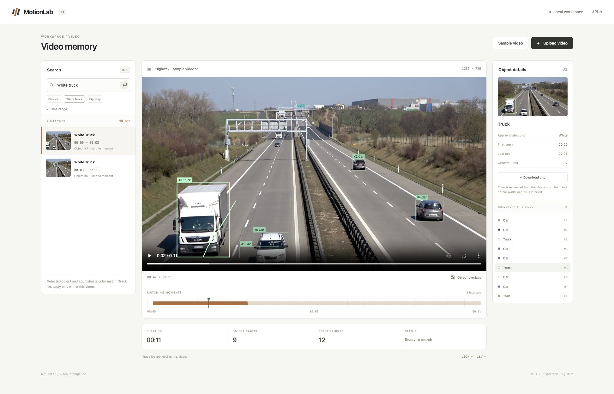
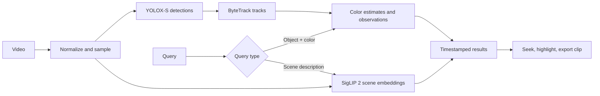

# MotionLab

Search a video, jump to a matching moment, and inspect the object in the frame.

MotionLab is a local video workspace with object tracking, approximate color filters, multilingual scene retrieval, and timestamped results. The interface and documentation are in English; both English and Turkish object queries are supported.



## What works

- Upload a video or open the included sample.
- Search for an object and color, such as **blue car** or **white truck**.
- Search for a scene description using multilingual SigLIP 2 embeddings.
- Click a result to seek to its representative frame and start playback.
- Inspect matching intervals on the timeline and tracked objects directly on the video.
- Download a contextual video clip or export observations as JSON / CSV.
- Reopen previously indexed videos after restarting the app.

Object results and scene suggestions are labeled separately. A scene similarity score is not a calibrated probability or proof that an event happened.

## Run locally

Requirements: Python 3.12 and [uv](https://docs.astral.sh/uv/).

```bash
make demo
```

Open **http://127.0.0.1:8002** and choose **Sample video**. Initial setup downloads the detector, semantic encoder, and example footage. No API key or paid inference service is required. Subsequent starts:

```bash
make serve
```

To use only your own videos:

```bash
make setup
make serve
```

The first version accepts videos up to **90 seconds, 200 MB, 4K and 120 FPS**. Playback is normalized to H.264 at 25 FPS with a maximum width of 1280 pixels. Object analysis runs at 5 FPS; semantic scene sampling runs at 1 FPS. Normalized playback and exported clips are silent in this version.

## How search works



Simple recognized object/color queries filter actual tracks. Free-form queries retrieve visually similar sampled scenes. Object intervals split when observations have a gap longer than 0.8 seconds; UI interpolation only spans neighboring observations up to 0.45 seconds apart. Scene suggestions use short windows around sampled frames and temporal suppression to avoid near-duplicate results.

## Models and reproducibility

- **YOLOX-S:** official ONNX release, COCO classes, checksum verified before use.
- **ByteTrack:** two-stage association through the `trackers` library.
- **SigLIP 2:** `google/siglip2-base-patch16-224`, revision pinned in source.
- **Color:** an HSV crop heuristic aggregated over a track; no color model was trained.

All neural weights are pretrained. This release does **not** claim detector fine-tuning, benchmark superiority, verified activity recognition, or real-world identity recognition. Each index records the video hash, detector hash, semantic revision, sampling rates, observations, and processing time. Dependencies are locked in `uv.lock`.

## API

| Method | Endpoint | Purpose |
| --- | --- | --- |
| POST | `/api/videos` | Upload a video as multipart `file` |
| POST | `/api/demo` | Index the local sample |
| GET | `/api/videos/{id}` | Processing status |
| GET | `/api/videos/{id}/search?q=blue%20car` | Search with optional `start` and `end` in seconds |
| GET | `/api/videos/{id}/index` | Tracks and observations |
| POST | `/api/videos/{id}/clip` | Prepare a clip and return its download URL from JSON `{ "start": 1, "end": 4 }` |
| GET | `/api/videos/{id}/export/{json\|csv}` | Export the index or observations |

Interactive API reference: `/docs`. The server binds to loopback only. Videos, indexes, and downloads stay on the local machine. Initial model/sample setup accesses the original download hosts.

## Verification and next experiments

```bash
make check
uv build
```

Tests cover query routing, color estimation, interval grouping, time filters, input validation, queue saturation, output access, and the video processing pipeline with deterministic model doubles. The initial local run passed 24 tests; the [smoke report](reports/smoke.json) also records real model inference, video upload, multilingual queries, and clip export. These are functional checks, **not retrieval or tracking accuracy measurements**. See [evaluation plan](docs/EVALUATION.md) for the next research milestone.

## Limits

The detector recognizes COCO object categories; custom objects can still be searched as scene suggestions, without grounded boxes. Small objects, occlusion, illumination, and viewpoint changes can break detection or tracking. Track IDs can fragment or switch. Approximate colors may reflect windows, shadows, or background pixels. One-second scene sampling can miss brief events. No action, license-plate, vehicle-model, face-identity, audio, or cross-video identity model is included.

This is a single-user local application with one indexing job at a time, not a hardened public upload service. Uploaded data is stored under `runs/`, which is excluded from Git. Model weights and sample media are downloaded locally rather than bundled in source control.

## Attribution

[YOLOX](https://github.com/Megvii-BaseDetection/YOLOX), [Trackers](https://github.com/roboflow/trackers), and [SigLIP 2](https://huggingface.co/google/siglip2-base-patch16-224) provide the pretrained inference components. The optional road footage is the [Roboflow Supervision sample video](https://supervision.roboflow.com/0.25.0/assets/), used for functional demonstration, not evaluation. See [NOTICE](NOTICE) for source and licensing details.
