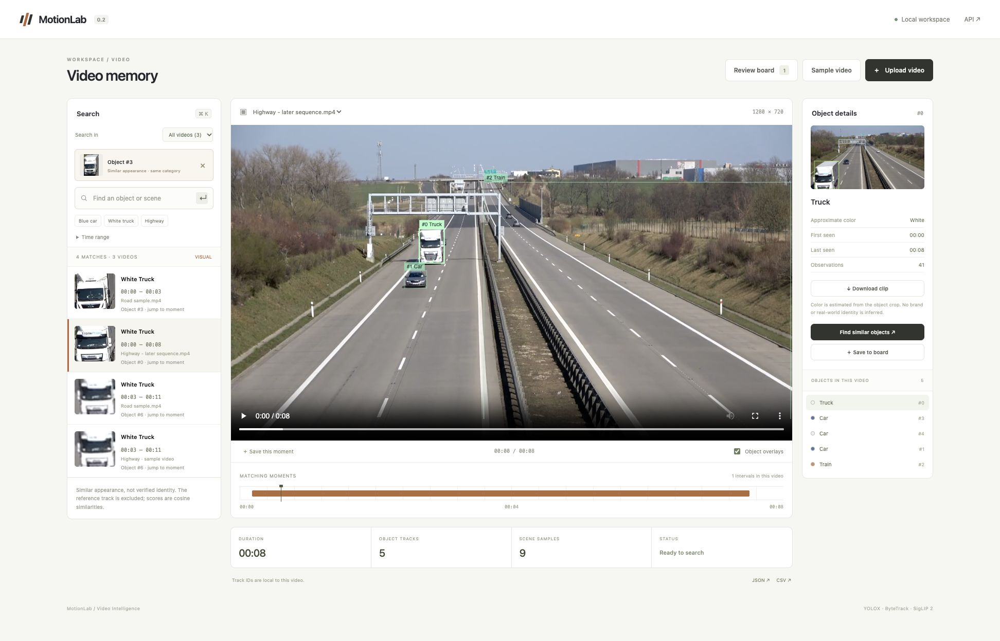
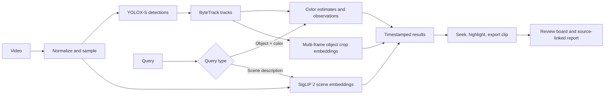
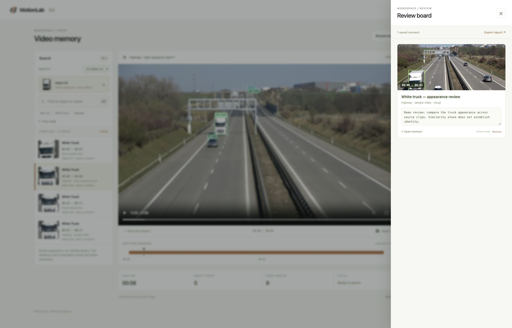

# MotionLab

Search your video library, follow visual matches, and collect source-linked moments.

MotionLab is a local video workspace with object tracking, approximate color filters, multilingual scene retrieval, visual object search, and a persistent review board. The interface and documentation are in English; both English and Turkish object queries are supported.



## What works

- Upload a video or open the included sample.
- Search for an object and color, such as **blue car** or **white truck**.
- Search for a scene description using multilingual SigLIP 2 embeddings.
- Search the current video or all indexed videos, with source names on every result.
- Select an object and use **Find similar objects** to compare its appearance across clips.
- Save results or arbitrary playback moments to the **Review board**, edit titles and notes, and reopen their source timestamps.
- Export a standalone HTML review report with embedded frames, notes, source links, and video hashes.
- Click a result to open its source video and play from the matching interval.
- Inspect matching intervals on the timeline and tracked objects directly on the video.
- Download a contextual video clip or export observations as JSON / CSV.
- Reopen previously indexed videos after restarting the app.

Object results and scene suggestions are labeled separately. A scene similarity score is not a calibrated probability or proof that an event happened.

## Run locally

Requirements: Python 3.12 and [uv](https://docs.astral.sh/uv/).

```bash
make demo
```

Open **http://127.0.0.1:8002** and choose **Sample video**. Initial setup downloads the detector, semantic encoder, and example footage. No API key or paid inference service is required. Subsequent starts:

```bash
make serve
```

To use only your own videos:

```bash
make setup
make serve
```

The application accepts videos up to **90 seconds, 200 MB, 4K and 120 FPS**. Playback is normalized to H.264 at 25 FPS with a maximum width of 1280 pixels. Object analysis runs at 5 FPS; semantic scene sampling runs at 1 FPS. Normalized playback and exported clips are silent in this version.

## How search works



Simple recognized object/color queries filter actual tracks. Free-form queries retrieve visually similar sampled scenes. Object intervals split when observations have a gap longer than 0.8 seconds; UI interpolation only spans neighboring observations up to 0.45 seconds apart. Scene suggestions use short windows around sampled frames and temporal suppression to avoid near-duplicate results.

### Appearance search and review workflow

Choose **All videos**, select a tracked object, then choose **Find similar objects**. MotionLab encodes up to three time-spread crops per track, normalizes their mean embedding, and ranks same-category tracks by cosine similarity. The reference track is excluded. Crop embeddings are cached locally and invalidated when the source index or model revision changes. This compares appearance; it does not establish that two tracks show the same physical object.

Save a result with **Save to board**, or use **Save this moment** below the player. Notes and titles autosave to SQLite and survive restarts. The report embeds its images, so it can be read offline; source links reopen the local app at the saved timestamp and require that app and its source files to be available.



## Models and reproducibility

- **YOLOX-S:** official ONNX release, COCO classes, checksum verified before use.
- **ByteTrack:** two-stage association through the `trackers` library.
- **SigLIP 2:** `google/siglip2-base-patch16-224`, revision pinned in source.
- **Color:** an HSV crop heuristic aggregated over a track; no color model was trained.

All neural weights are pretrained. This release does **not** claim detector fine-tuning, benchmark superiority, verified activity recognition, or real-world identity recognition. Each index records the video hash, detector hash, semantic revision, sampling rates, observations, and processing time. Dependencies are locked in `uv.lock`.

## API

| Method | Endpoint | Purpose |
| --- | --- | --- |
| POST | `/api/videos` | Upload a video as multipart `file` |
| POST | `/api/demo` | Index the local sample |
| GET | `/api/videos/{id}` | Processing status |
| GET | `/api/videos/{id}/search?q=blue%20car` | Search with optional `start` and `end` in seconds |
| GET | `/api/search?q=blue%20car&scope=library` | Search across ready videos; use `scope=video&video_id=…` for one source |
| POST | `/api/similar` | Appearance search from JSON `{ "video_id": "…", "track_id": 3, "scope": "library" }` |
| GET / POST | `/api/board` | List or save reviewed moments |
| PATCH / DELETE | `/api/board/{id}` | Edit notes and titles, or remove a moment |
| GET | `/api/board-export` | Download the standalone HTML report |
| GET | `/api/videos/{id}/index` | Tracks and observations |
| POST | `/api/videos/{id}/clip` | Prepare a clip and return its download URL from JSON `{ "start": 1, "end": 4 }` |
| GET | `/api/videos/{id}/export/{json\|csv}` | Export the index or observations |

Interactive API reference: `/docs`. The server binds to loopback only. Videos, indexes, and downloads stay on the local machine. Initial model/sample setup accesses the original download hosts.

## Verification and next experiments

```bash
make check
uv build
```

Tests cover query routing, color estimation, interval grouping, time filters, input validation, queue saturation, output access, and the video processing pipeline with deterministic model doubles. The current local run passed 31 tests, including cross-video source attribution, single-encoding library queries, crop cache reuse, reference exclusion, review persistence, input validation, and escaped report content. The [initial smoke report](reports/smoke.json) records real model inference, video upload, multilingual queries, and clip export; the [workspace smoke report](reports/workspace-smoke.json) records the added review workflow. These are functional checks, **not retrieval or tracking accuracy measurements**. See [evaluation plan](docs/EVALUATION.md) for the next research milestone.

## Limits

The detector recognizes COCO object categories; custom objects can still be searched as scene suggestions, without grounded boxes. Small objects, occlusion, illumination, and viewpoint changes can break detection or tracking. Track IDs can fragment or switch. Approximate colors may reflect windows, shadows, or background pixels. One-second scene sampling can miss brief events. No action, license-plate, vehicle-model, face-identity, audio, or cross-video identity model is included.

This is a single-user local application with one indexing job at a time, not a hardened public upload service. Uploaded data is stored under `runs/`; review metadata is stored in `workspace.sqlite`. Both are excluded from Git. Model weights and sample media are downloaded locally rather than bundled in source control.

## Attribution

[YOLOX](https://github.com/Megvii-BaseDetection/YOLOX), [Trackers](https://github.com/roboflow/trackers), and [SigLIP 2](https://huggingface.co/google/siglip2-base-patch16-224) provide the pretrained inference components. The optional road footage is the [Roboflow Supervision sample video](https://supervision.roboflow.com/0.25.0/assets/), used for functional demonstration, not evaluation. See [NOTICE](NOTICE) for source and licensing details.
