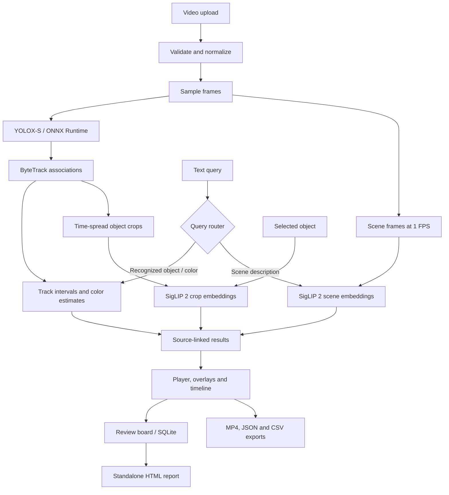

<div align="center">

# MotionLab

**A local video search and review workspace**

Search by text or object appearance. Open the matching moment. Keep a review trail.

[](https://github.com/onurozansunger/motionlab/actions/workflows/checks.yml)
[](pyproject.toml)
[](pyproject.toml)
[](LICENSE)

[Quick start](#quick-start) · [Product walkthrough](#product-walkthrough) · [Architecture](#architecture) · [API](#api) · [Verification](#verification)

</div>


MotionLab turns short videos into a searchable collection of object tracks and scene representations. Results retain their source video and time interval, so you can move from a query to the relevant frame, inspect it, save a note, or export a clip.

The project combines pretrained computer vision models with custom indexing, retrieval, playback, and review workflows. **No neural model was trained or fine-tuned for this release.** The engineering contribution is the application around inference: three retrieval paths, temporal grounding, cached track representations, source-aware navigation, and persistent review records.

## At a glance

| Capability | What you can do |
| --- | --- |
| Object and color search | Find detected tracks with queries such as `blue car`, `white truck`, or `mavi araba`. |
| Scene search | Retrieve sampled scenes using a free-form description such as `a highway with cars`. |
| Visual object search | Select an object and rank tracks with similar appearance in the current video or the whole library. |
| Timestamped playback | Click a result to open its source video and play from the matching interval. |
| Object inspection | Inspect boxes, track paths, approximate colors, observations, and matching intervals. |
| Review board | Save moments, edit titles and notes, and return to the original timestamp after restarting. |
| Exports | Download MP4 clips, JSON indexes, CSV observations, or an HTML review report with embedded frames. |
| Local inference | Run on CPU without an API key or paid inference endpoint. |

The interface is in English. Object-query aliases include English and Turkish; scene retrieval uses a multilingual encoder. Text support is not a claim of equal retrieval quality across languages.

## Quick start

**Requirements:** Python 3.12 or 3.13, [uv](https://docs.astral.sh/uv/getting-started/installation/), and Git. The Makefile commands below also require `make`. Python 3.12 is used in CI. No GPU is required.

```bash
git clone https://github.com/onurozansunger/motionlab.git
cd motionlab
make demo
```

Open **[localhost:8002](http://127.0.0.1:8002)** and select **Sample video** to index the downloaded footage. `make demo` installs the locked dependencies, downloads the models and sample, and starts the server. The first run needs an internet connection and time for the downloads.

For later starts:

```bash
make serve
```

To work with your own videos instead:

```bash
make setup
make serve
```

<details>
<summary><strong>Equivalent commands without make</strong></summary>

```bash
uv sync --locked --no-editable --python 3.12
uv run --no-editable motionlab setup
uv run --no-editable motionlab demo-video
uv run --no-editable motionlab serve
```

Skip `demo-video` if you do not need the sample. FFmpeg is accessed through `imageio-ffmpeg`; the application does not require a separate system FFmpeg installation.

</details>

<details>
<summary><strong>Port, storage, and model cache</strong></summary>

Use another local port:

```bash
uv run --no-editable motionlab serve --port 8003
```

`MOTIONLAB_HOME` sets the directory for detector weights, sample media, indexes, and the review database. It defaults to the working directory. Use the same value for setup and serving:

```bash
export MOTIONLAB_HOME="$PWD/.motionlab-data"
uv run --no-editable motionlab setup
uv run --no-editable motionlab serve
```

SigLIP 2 uses the Hugging Face cache, which is separate from `MOTIONLAB_HOME`. Initial setup fetches model files from GitHub and Hugging Face; the optional sample comes from Roboflow. Inference runs locally. Keep the model cache available for subsequent starts.

</details>

## Product walkthrough

1. **Index a clip.** Upload a video or choose the sample. The workspace shows progress as it normalizes frames and indexes objects and scenes.
2. **Search with text.** Try `blue car` for track-based results, then `a highway with cars` for semantic scene suggestions. Set **Search in → All videos** to search the library.
3. **Search from an object.** Select a track and choose **Find similar objects**. The reference crop appears above the results; each match includes its source filename.
4. **Review the source.** Select a result to open its video at the matching interval. Inspect the object and timeline, or prepare a contextual clip for download.
5. **Keep the useful moments.** Use **Save to board** on a result or **Save this moment** beneath the player. Add a title and review note.
6. **Export the review.** Open **Review board → Export report** to download one HTML file containing snapshots, notes, intervals, source links, and video hashes.


The report can be read offline because snapshots are embedded. Its source links require the local app to be running at the linked address with the corresponding indexed videos available. Track IDs belong to individual videos; they do not identify an object across cameras.

## Three retrieval paths

| Mode | Input | Matching method | Interpretation |
| --- | --- | --- | --- |
| **Object** | Recognized class/color query | Filters detected tracks and groups observations into intervals | A detector-backed class and approximate color match |
| **Semantic** | Free-form scene description | Text-to-frame cosine similarity using SigLIP 2 | A visually related scene suggestion; no grounded object box |
| **Visual** | Selected tracked object | Track-to-track cosine similarity from aggregated crop embeddings | Similar appearance, not verified identity |

### Object search

Recognized object/color aliases route to structured filters. Observation gaps longer than **0.8 seconds** split a track into separate result intervals. Playback overlays interpolate only between nearby observations, up to **0.45 seconds** apart, to avoid drawing continuous motion across longer gaps.

Queries outside the recognized filter vocabulary route to semantic retrieval. The detector's 80 COCO classes and the structured query vocabulary are not identical; not every multiword class name has a structured alias.

### Scene search

The application samples full frames at **1 FPS**, computes normalized image embeddings, and compares them with the query embedding. Library search encodes the text once and reuses it across videos. Temporal suppression reduces adjacent scene suggestions.

Similarity scores are not probabilities. A result for a detailed description does not verify that every stated attribute or action occurred. Semantic search can return suggestions even when no scene satisfies the query.

### Visual search

For each track, MotionLab selects up to **three confidence-based, time-spread crops**. It encodes the crops, averages their embeddings, and normalizes the resulting vector. The UI ranks tracks of the same detected category and excludes the reference track itself.

Crop vectors are built on demand and cached. A fingerprint of the video hash, track data, model identifier, revision, and cache schema determines whether they can be reused. This adds appearance search to existing indexes without re-running detection.

## Architecture



| Layer | Implementation |
| --- | --- |
| Inference | YOLOX-S through ONNX Runtime; SigLIP 2 through Transformers / PyTorch; CPU execution |
| Tracking and attributes | ByteTrack via `trackers`; HSV crop-color heuristics aggregated over a track |
| Indexing | OpenCV frame processing, FFmpeg normalization, JSON metadata, NumPy embedding arrays |
| Retrieval | Structured filters and exact cosine ranking over locally stored embeddings |
| Service | FastAPI, one background indexing worker, bounded indexing/export concurrency |
| Review storage | SQLite metadata and per-video snapshot files |
| Interface | Vanilla JavaScript, HTML/CSS, native video playback, canvas overlays |
| Reproducibility | Locked dependencies, pinned model revision, detector checksum, index provenance |

### Model provenance

| Component | Configuration |
| --- | --- |
| Detector | Official YOLOX-S ONNX release; 640 × 640 input; 80 COCO classes |
| Detector integrity | SHA-256 verified at setup and model load |
| Embedding model | `google/siglip2-base-patch16-224` |
| Embedding revision | `75de2d55ec2d0b4efc50b3e9ad70dba96a7b2fa2` |
| Color estimation | HSV heuristic, not a trained attribute model |

Each index records the normalized video's hash, detector hash, semantic model revision, sampling rates, observations, and processing time. The hash identifies the normalized analysis video, not the original uploaded file. See [model implementation](src/motionlab/vision.py) and [pipeline](src/motionlab/pipeline.py).

## API

Interactive documentation is available at **[localhost:8002/docs](http://127.0.0.1:8002/docs)** while the server is running.

| Method | Endpoint | Purpose |
| --- | --- | --- |
| `GET` | `/health` | Service version and detector/sample file availability |
| `POST` | `/api/videos` | Upload a video as multipart field `file`; returns a job with HTTP 202 |
| `GET` | `/api/videos` | List video jobs |
| `GET` | `/api/videos/{id}` | Read indexing progress or ready/error status |
| `POST` | `/api/demo` | Index the installed sample |
| `GET` | `/api/search` | Text search with `q`, `scope`, optional `video_id`, `start`, and `end` |
| `POST` | `/api/similar` | Appearance search using a video ID and track ID |
| `GET` | `/api/videos/{id}/index` | Read tracks and observations |
| `GET` | `/api/videos/{id}/search` | Search a single video |
| `POST` | `/api/videos/{id}/clip` | Prepare an MP4 and return its download URL |
| `GET` | `/api/videos/{id}/export/{format}` | Export `json` or `csv` |
| `GET` / `POST` | `/api/board` | List or save moments |
| `PATCH` / `DELETE` | `/api/board/{id}` | Edit a title/note or remove a saved moment |
| `GET` | `/api/board-export` | Download the HTML report |

<details>
<summary><strong>Example requests</strong></summary>

Upload a clip, then use the returned `id` to poll its status until `ready`:

```bash
curl -F 'file=@/path/to/clip.mp4' http://127.0.0.1:8002/api/videos
curl http://127.0.0.1:8002/api/videos/VIDEO_ID
```

Search all ready videos:

```bash
curl --get http://127.0.0.1:8002/api/search \
  --data-urlencode 'q=blue car' \
  --data-urlencode 'scope=library'
```

Find visually similar tracks. Replace `VIDEO_ID` and the example track ID with values from your index:

```bash
curl http://127.0.0.1:8002/api/similar \
  -H 'Content-Type: application/json' \
  -d '{"video_id":"VIDEO_ID","track_id":3,"scope":"library","same_class":true}'
```

Prepare a clip, with start/end measured in seconds:

```bash
curl http://127.0.0.1:8002/api/videos/VIDEO_ID/clip \
  -H 'Content-Type: application/json' \
  -d '{"start":1,"end":4}'
```

The clip endpoint returns JSON containing a download URL; it does not return MP4 bytes directly. A second upload while indexing is in progress receives HTTP 429. Invalid video inputs are rejected before indexing.

</details>

## Verification

```bash
make check
uv build
```

`make check` runs Ruff linting, formatting checks, pytest, and JavaScript syntax validation. Node.js is needed for the syntax check, not to run the application. GitHub Actions runs these checks and builds the Python package on Ubuntu with Python 3.12.

| Evidence | Recorded result | Scope |
| --- | --- | --- |
| Automated tests | **31 passed** in the recorded local run | Query routing, temporal grouping, validation, pipeline behavior, cache reuse, reference exclusion, persistence, report escaping |
| Original application smoke test | [Report](reports/smoke.json) | Real inference, upload, English/Turkish queries, negative object query, clip download |
| Workspace smoke test | [Report](reports/workspace-smoke.json) | Visual retrieval, source switching, note persistence after restart, HTML download and timestamp links |
| Packaging | Wheel and source distribution built | Installable Python package |

Automated inference-path tests use deterministic model doubles; the smoke reports separately document real-model checks. **These are functional results, not retrieval or tracking accuracy measurements.** The appearance-search demo uses related road clips, including duplicate footage, and cannot establish cross-camera retrieval performance.

[The evaluation plan](docs/EVALUATION.md) defines detection/tracking, temporal retrieval, color, and appearance-retrieval experiments, including held-out video splits and ablations. No AP, HOTA, IDF1, Recall@K, or mAP result is claimed yet.

## Constraints and known failure modes

| Area | Current behavior |
| --- | --- |
| Input | Up to 90 seconds, 200 MiB, 3840 × 2160 pixel area, and 120 FPS; MP4/MOV recommended |
| Playback | Silent H.264, 25 FPS, maximum width 1280 pixels |
| Analysis | Object analysis at 5 FPS; full-frame semantic sampling at 1 FPS |
| Concurrency | One indexing job at a time; intended for a single-user local workspace |
| Scale | Exact local ranking; no vector database or large-library latency benchmark |
| Tracking | Occlusion, small objects, and viewpoint changes can fragment tracks or switch IDs |
| Detection and color | False categories and boxes can occur; crop colors can include windows, shadows, or background |
| Semantics | Brief events may be missed; scene similarity does not verify actions or identities |
| Appearance search | Similar-looking objects may rank together; duplicate source footage can dominate results |

License-plate OCR, vehicle make/model recognition, face identification, audio search, and verified cross-video identity are **not implemented**. The server binds to `127.0.0.1` and has no multi-user authentication or public upload-service hardening.

### Local data

The default workspace stores normalized videos and derived artifacts under `runs/`, detector weights under `models/`, optional sample footage under `data/`, and review metadata in `workspace.sqlite`. These paths are excluded from Git. The temporary uploaded source is removed after normalization; retain your originals separately. Back up `runs/` and `workspace.sqlite` together to preserve saved source moments.

### Troubleshooting

- **Models missing or checksum failure:** rerun `uv run --no-editable motionlab setup`. If an existing detector file fails validation, move it aside before running setup again so a clean copy can be downloaded.
- **Sample unavailable:** run `uv run --no-editable motionlab demo-video` using the same `MOTIONLAB_HOME` as the server.
- **Port already in use:** start with `--port 8003` and open that port in your browser.
- **Processing interrupted:** an unfinished job is marked as an error after a restart; upload the clip again.
- **Unexpected search results:** check the result mode. A free-form query produces scene suggestions; object/color aliases produce track filters.

## Repository map

```text
src/motionlab/
├── api.py              # HTTP endpoints, jobs, uploads, clip exports
├── cli.py              # Setup, sample download, local server
├── pipeline.py         # Validation, normalization, video indexing
├── vision.py           # Pinned model loading, detection, embeddings, colors
├── search.py           # Query routing and temporal retrieval
├── workspace.py        # Visual search, crop cache, SQLite board, HTML report
└── static/             # Browser interface, video controls and overlays
tests/                  # Unit and integration tests
docs/EVALUATION.md      # Evaluation design and planned ablations
reports/                # Screenshots and recorded functional smoke results
.github/workflows/      # Automated checks and package build
```

## Next experiments

- [ ] Annotate a held-out video retrieval set with positive and negative queries.
- [ ] Measure temporal Recall@K, appearance-retrieval mAP, and tracking quality.
- [ ] Compare single-crop and multi-crop track representations.
- [ ] Evaluate denser scene sampling against indexing cost and retrieval quality.
- [ ] Investigate foreground-aware color estimation and external image-example queries.

## License and attribution

MotionLab application code is released under the [MIT license](LICENSE). Third-party models, libraries, and media retain their own terms; see [NOTICE](NOTICE).

The pretrained components come from [YOLOX](https://github.com/Megvii-BaseDetection/YOLOX), [Trackers](https://github.com/roboflow/trackers), and [SigLIP 2](https://huggingface.co/google/siglip2-base-patch16-224). The optional road footage comes from the [Roboflow Supervision video examples](https://media.roboflow.com/supervision/video-examples/vehicles.mp4). Screenshots show this sample for demonstration; the video and model weights are not bundled in the repository.

Built by [Onur Ozan Sünger](https://github.com/onurozansunger).
